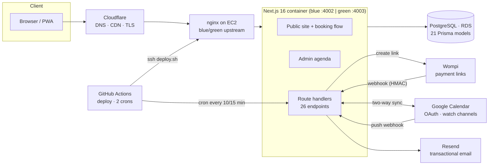

# NutriChef Pao — booking & patient-records platform (case study)

> A production web platform for a nutrition practice in El Salvador: public site, pay-to-confirm online booking, two-way Google Calendar sync, card payments with webhook reconciliation, and an admin agenda. Designed, built and operated solo in **7 weeks** (48 commits, May–June 2026). Live at [nutrichefpao.com](https://nutrichefpao.com).
>
> This repository documents architecture, decisions and numbers. The source is private.

**Role:** sole engineer (product, backend, frontend, infra, ops) · **Stack:** Next.js 16 (App Router) · React 19 · TypeScript · Prisma 7 · PostgreSQL (AWS RDS) · Tailwind 4 · Docker · nginx · AWS EC2 · Cloudflare · GitHub Actions · Wompi · Google Calendar API · Resend

---

## The problem

The practice took bookings by WhatsApp and kept the agenda in Google Calendar. Slots were double-booked, deposits were chased by hand, and no-shows were common. The owner wanted patients to book and pay online **without creating an account**, while she kept working from Google Calendar on her phone.

## Architecture

## Numbers

| | |
|---|---|
| Time to production | 7 weeks, 48 commits |
| Code | ~12,000 lines of TypeScript/TSX (plus template CSS) |
| Data model | 21 Prisma models, 4 enums, 5 migrations |
| Surface | 21 pages, 26 API route handlers, 43 React components |
| Incremental hosting cost | **$0/month** (shared EC2, Cloudflare and GitHub free tiers) |
| Docker image | ~150 MB (3-stage build, `output: "standalone"`) |

## Key design decisions

### 1. Pay-to-confirm booking with a soft hold
A booking is created in `PENDING_PAYMENT` with a frozen price and an expiry. The slot is held while the patient pays; if payment never arrives the hold expires and the slot frees itself. No account, no password: the patient gets a confirmation email with an `.ics` attachment.

### 2. Availability is computed in one place, and the database has the last word
A single availability module generates slots from the weekly schedule, subtracts calendar blocks, confirmed bookings and unexpired holds, and applies lead time and a booking horizon, all in the `America/El_Salvador` timezone. Even so, concurrency is settled by a **partial unique index** on `Booking(scheduledAt) WHERE status = 'CONFIRMED'`: two people cannot confirm the same slot, whatever the application layer believes.

### 3. Payments: verify, dedupe, reconcile
- The Wompi webhook verifies an **HMAC-SHA256** signature over the raw body with a constant-time comparison before touching the database.
- Events are **idempotent** (keyed by transaction id) with anti-replay, and the amount is checked against the booking to stop tampering.
- Reconciliation has four layers: the webhook, the redirect-return check, status polling with a per-booking cooldown, and a **15-minute cron** that sweeps recent pending bookings and asks Wompi directly. A lost webhook never loses a payment.
- Every inbound and outbound Wompi interaction is written to an audit table (secrets redacted, bodies truncated) and visible in an admin audit screen with KPIs and filters.

### 4. Two-way Google Calendar sync that cannot loop
- OAuth 2.0 connect with a CSRF state cookie; tokens encrypted at rest with **AES-256-GCM**.
- Site → Google: each booking mirrors to a calendar event (insert, patch, delete, color by status).
- Google → site: incremental sync with a sync token. Events tagged with a booking id reschedule or cancel the booking; the owner's personal events become blocks so nobody can book over them.
- Push notifications via `events.watch` channels (7-day TTL) renewed by a **10-minute cron**, plus a manual "Sync now".
- An anti-echo guard prevents update loops; on conflict the database wins and the owner is emailed.
- Fallback: a token-protected `.ics` subscription feed (hand-written RFC 5545 generator) that omits patient emails.

### 5. Admin agenda the owner actually uses
FullCalendar with day/week/month/list views, drag-and-drop rescheduling (reverting on a 409 conflict), create/edit/mark-paid modal, blocks for days or time ranges, weekly schedule editor and a services CRUD.

### 6. Zero-downtime deploys on a $0 budget
`deploy.sh` on push to `main`: detect the active color from the nginx upstream, build the image, start the other color, poll `/health` for up to 90 s, rewrite the upstream, `nginx -t`, graceful reload with a drain window, and **automatic rollback** if the health check or the config test fails. A per-build asset version busts browser, Cloudflare and service-worker caches without manual purges.

### 7. Security choices that fit a one-container app
- Admin auth with PBKDF2-SHA256 passwords and server-side sessions (httpOnly cookie, only a SHA-256 hash of the token stored).
- Constant-time comparison for cron, webhook and feed tokens.
- A dependency-free fixed-window rate limiter (login 10/IP and 5/email per 15 min, bookings 12/min, availability 60/min, webhook 120/min), valid because nginx routes to exactly one active container.
- Patient-record schema (SOAP consultation notes, medical history, anthropometry, labs, goals, documents) designed with cascade deletes and PII minimisation from day one; the clinical UI is the next phase.

## What I would do next
- Finish the patient portal: magic-link login (schema already in place), clinical notes UI, signed-URL documents on S3.
- Move the rate limiter to Redis before scaling to more than one container.
- Session rotation and "log out everywhere".
- Retention policy for the payment audit table.

## Lessons
- Idempotency and reconciliation are cheaper than a single missed payment. Build the sweep before launch.
- Let the database enforce the invariant you care about most. Application checks are for UX; unique indexes are for truth.
- Two-way sync needs an identity on both sides and a loop guard, or it will fight itself.
- A purchased HTML template saved weeks of design, at the price of working around its animations with plain `<a>`/`` tags. Worth it for a solo launch.

---

Walter Salazar · [GitHub profile](https://github.com/wsalazar1989) · [LinkedIn](https://www.linkedin.com/in/waltersalazarg1989)
